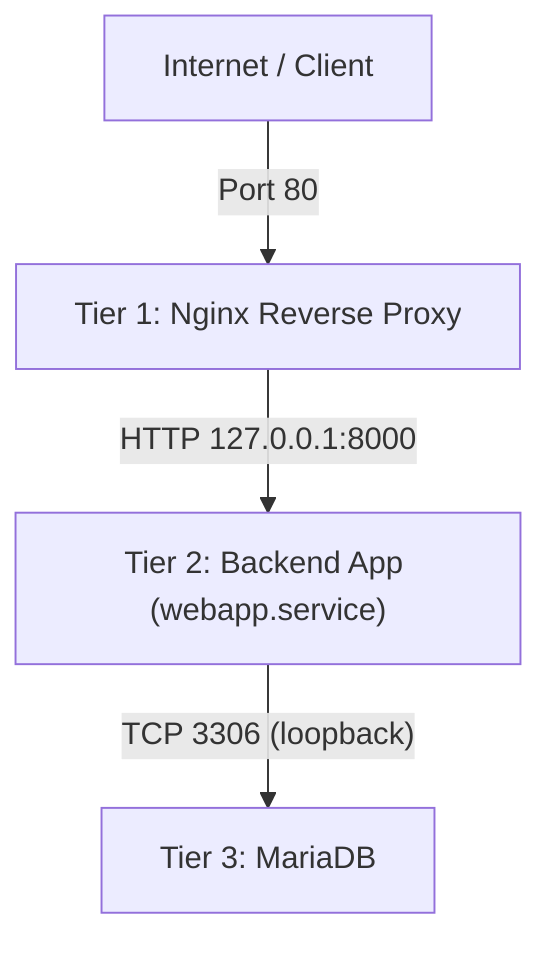

# uk5-multitier-deploy

Milestone 2 UK5 Sistem Operasi

## Anggota Kelompok

| No | Peran | Anggota | File |
|----|-------|---------|------|
| 1 | Master Installer | Muhammad Yaqut Al-Mu'tasimy | deploy.sh, 01_setup_users.sh, env.example |
| 2 | Systemd & Aplikasi | Muhammad Al-Rizky Wijayanto | webapp.service, app.py, 03_configure_sec.sh |
| 3 | Nginx & Database | Nur Jannah Desita | 02_install_deps.sh, nginx.conf.template, database.cnf |
| 4 | Repo & Dokumentasi | Nadya Arifatus Zahra | README.md + diagram, health_check.sh, laporan akhir |

## Arsitektur



## Cara Pakai

## Cara Pakai

1. Clone repositori:

```bash
git clone https://github.com/nadyaarifatus28-ui/uk5-multitier-deploy.git
cd uk5-multitier-deploy
```

2. Salin template environment dan isi nilainya:

```bash
cp env.example .env
chmod 600 .env
```

3. Jalankan installer, lalu jalankan sekali lagi untuk membuktikan idempotensi (harus tanpa error):

```bash
sudo bash deploy.sh
sudo bash deploy.sh
```

4. Verifikasi:

```bash
bash tests/health_check.sh
```
